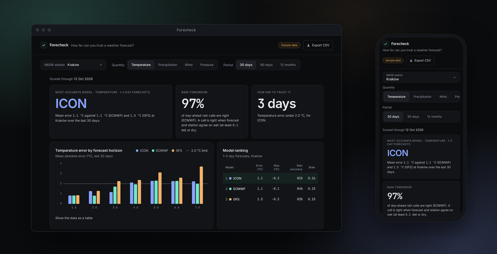
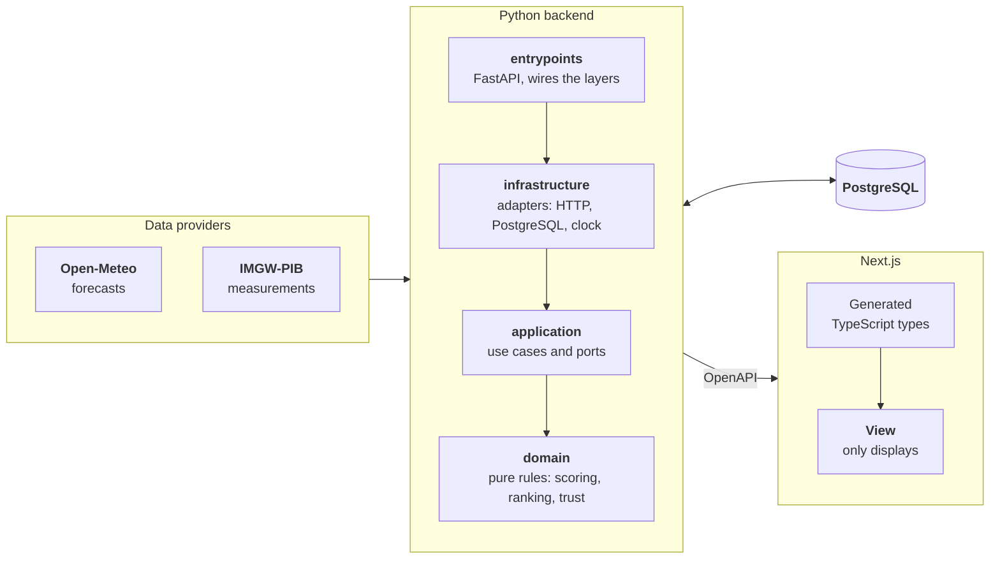

<div align="center">
  <h1>Forecheck: how far can you trust a weather forecast?</h1>
  <picture>
    <source media="(prefers-color-scheme: dark)" srcset="docs/brand/banner-dark.svg">
    
  </picture>
</div>

<br>

<div align="center">
  
  
  
  
  
  
  <br>
  
  
  
  
  
  
</div>

---

<div align="center">
  
  <p><em>The screenshot uses made-up demo data, which is why the page shows a "Sample data" badge.</em></p>
</div>

---

**Forecheck** answers one question: *at my station, which weather model has been right lately, and for how many days
ahead can I rely on it?* It checks the forecasts **against real measurements in Poland**.

Every day it saves what **three open models** (ICON, ECMWF and GFS) predict for the **next 7 days** at **15 IMGW
stations**, and once a day has been measured, it scores each forecast. Scores run about two weeks behind, because IMGW
publishes a month of data after it ends.

The page gives you a **clear verdict**, for example: "ECMWF is the most accurate here, and its temperature error stays
under 2 °C for 3 days." **No accounts, no ads**, and all of it is open source.

## 📖 Table of contents

1. [✨ What it does](#-what-it-does)
2. [🧪 How a forecast is judged](#-how-a-forecast-is-judged)
3. [🧱 Stack](#-stack)
4. [🔧 How it's built](#-how-its-built)
5. [🚀 Run it locally (development)](#-run-it-locally-development)
6. [☁️ Run it on a host](#️-run-it-on-a-host)
7. [📜 Data and licences](#-data-and-licences)
8. [⚠️ Known limits](#️-known-limits)
9. [📚 Documentation](#-documentation)

## ✨ What it does

1. **A verdict first.** The most accurate model for your station, how often tomorrow's rain call is right, and how many
   days ahead the best model stays within a set error.
2. **Error by horizon.** Grouped bars for 1 to 7 days ahead, per model, with the trust limit drawn in.
3. **A ranking.** Mean error and bias for temperature, wind and pressure. Accuracy, hit rate, false alarms and Brier score for rain.
4. **A station comparison.** The best model at every station, in one list.
5. **CSV export** of every figure, with the data attributions inside the file.
6. **No accounts, no ads.** Your last station is remembered in the browser only.

Quantities: temperature, precipitation, wind and pressure. Periods: 30 days, 90 days, 12 months.

## 🧪 How a forecast is judged

- **Forecasts are kept as they were issued.** Each carries the day it was fetched and its lead time in days. A forecast
  refreshed just before its day would make every model look better than it was when anyone could still act on it.
- **Truth is a station measurement, nothing else.** IMGW synoptic reports, rebuilt into UTC days. Reanalysis such as
  ERA5 is a model, so it is never used as truth.
- **Metrics.** Mean absolute error, bias and RMSE for temperature, wind and pressure. For rain, a yes/no call at 0.1 mm
  a day (accuracy, hit rate, false alarm ratio) and a Brier score.
- **Trust horizon.** The largest lead N such that every lead from 1 to N meets the bar: 2 °C for temperature, 1.5 m/s for
  wind, 2 hPa for pressure, 80% right calls for rain. All of these are settings.
- **Few days, no ranking.** A model with fewer than 10 scored days is listed but not ranked.

The full method, with its limits, is in [`docs/spec.md`](docs/spec.md).

## 🧱 Stack

| Layer | Technology |
| :--- | :--- |
| View | Next.js 16 (App Router), React 19, TypeScript (strict), Tailwind CSS 4 |
| API and logic | Python 3.13, FastAPI, Pydantic v2, httpx |
| Contract | OpenAPI generated by FastAPI, TypeScript types generated by openapi-typescript |
| Data access | SQLAlchemy 2 (Core), psycopg 3, Alembic |
| Database | PostgreSQL (Neon in production, local in the dev container) |
| Sources | Open-Meteo (forecasts), IMGW-PIB (measurements) |
| Quality | ruff, mypy `--strict`, import-linter, pytest, hypothesis, ESLint, Vitest, axe-core |
| Tooling | uv, GitHub Actions (CI), Dev Containers |
| Hosting | Vercel Hobby (one project: Next.js and a Python function), Neon Free |

## 🔧 How it's built

Python owns the data, the database and every calculation. Next.js only displays what the API returns.



Inside the backend, arrows show the only direction imports may go.

- **Hexagonal.** The domain imports only the standard library. `import-linter` fails CI if a layer reaches the wrong way.
- **Ports.** `ForecastSource`, `ForecastArchive`, `ObservationSource`, repositories, `Clock`. Swapping a provider means
  writing one adapter.
- **Contract between languages.** FastAPI publishes OpenAPI, `openapi-typescript` turns it into types, and CI fails if
  the generated file is stale.
- **Scores are summable.** Each scored day is stored as small sums, so a ranking over any period is one SQL aggregate and
  raw forecasts are dropped once scored.

More in [`docs/architecture.md`](docs/architecture.md).

## 🚀 Run it locally (development)

A **development** setup in a dev container. You need Docker and VS Code with the Dev Containers extension. To deploy it,
see [Run it on a host](#️-run-it-on-a-host).

1. **Create your settings file.** The defaults work locally.

   ```bash
   cp .env.example .env
   ```

2. **Open the project in the dev container.** In VS Code run **Dev Containers: Reopen in Container**. It installs Node,
   Python and PostgreSQL, creates the databases and applies the migrations.

3. **Add some data.** The database starts empty, so fill it with made-up scores (the page flags them with a "Sample data"
   badge). In the container's terminal:

   ```bash
   uv run python scripts/seed_demo.py
   ```

4. **Start the app.** This runs Next.js on port 3000 and the API on port 8000.

   ```bash
   npm run dev
   ```

5. **Open it.** Go to http://localhost:3000 (not `127.0.0.1`: the Next.js dev server only allows `localhost`).

For real history instead of demo data, see [`docs/operations.md`](docs/operations.md#starting-with-a-history). Everything
else is in [`docs/dev-environment.md`](docs/dev-environment.md).

## ☁️ Run it on a host

The only difference between development and production is the environment variables.

1. Create a [Neon](https://neon.com) project and copy its **pooled** connection string and its **direct** one.
2. Import the repository into [Vercel](https://vercel.com). Keep the detected Next.js preset.
3. Set the variables:

| Variable | Value |
| :--- | :--- |
| `DATABASE_URL` | Neon pooled connection string |
| `DIRECT_URL` | Neon direct connection string (used by migrations only) |
| `CRON_SECRET` | any long random string (`openssl rand -base64 32`) |
| `APP_URL` | the address of your deployment, sent to the data providers in the User-Agent (optional) |
| `CONTACT_EMAIL` | your address, sent to the data providers in the User-Agent |

4. Deploy. A production build applies the migrations, and a daily cron job then collects, reads and scores.

Details, limits and what to do when a step fails: [`docs/operations.md`](docs/operations.md).

## 📜 Data and licences

The code is MIT. The data keeps its own terms, and both providers require credit on every page that shows it. The page
footer and the CSV export carry it.

- **Forecasts:** [Open-Meteo](https://open-meteo.com/), CC BY 4.0, free for **non-commercial** use only (no ads, no
  subscriptions). Forecheck makes about 15 calls a day against a limit of 10,000.
- **Measurements:** IMGW-PIB, under the [regulation](https://danepubliczne.imgw.pl/regulations) of the open data service.
  The scores are processed data, so both required notices are shown, in the regulation's own words:
  - Źródłem pochodzenia danych jest Instytut Meteorologii i Gospodarki Wodnej – Państwowy Instytut Badawczy
  - Dane Instytutu Meteorologii i Gospodarki Wodnej – Państwowego Instytutu Badawczego zostały przetworzone

What was checked against the providers, and how, is in [`docs/data-sources.md`](docs/data-sources.md).

## ⚠️ Known limits

- **Scores run about two weeks behind.** IMGW publishes a month of hourly data after the month ends, so a forecast for
  1 October is scored in the second half of November at the earliest. The page shows how far scoring has got.
- **A fresh install has no history.** Open-Meteo's Previous Runs archive can fill in months at once, but the figures are
  only as good as the days they rest on, and the page says how many that is.
- **"1 day ahead" is counted from the fetch time.** Open-Meteo does not say when a model run started, so the lead is a
  whole-day approximation, the same for every model.
- **The rain Brier score is approximate.** The chance of rain Open-Meteo gives is the day's highest hourly chance, not the
  chance of 0.1 mm over the whole day. History from the archive carries no Brier score at all.
- **Dębica has no IMGW synoptic station.** Tarnów, the nearest, stands in for it. Pressure is missing at Zakopane.
- **Not verified on a real deployment.** Importing the Python package on Vercel and running Alembic in the Vercel build
  are checked locally but unproven there. See [`docs/operations.md`](docs/operations.md#verification-status).

## 📚 Documentation

| Document | What it covers |
| :--- | :--- |
| [`docs/spec.md`](docs/spec.md) | The method: definitions, metrics, ranking, trust horizon, and their limits |
| [`docs/architecture.md`](docs/architecture.md) | Layers, ports, data model, the daily cycle, caching, and the decisions behind them |
| [`docs/data-sources.md`](docs/data-sources.md) | What Open-Meteo and IMGW really provide, as checked, and how a day is built |
| [`docs/dev-environment.md`](docs/dev-environment.md) | The dev container, commands, tests, demo data |
| [`docs/operations.md`](docs/operations.md) | Deploying, the daily job, history, limits, troubleshooting |
| [`docs/extending.md`](docs/extending.md) | Adding a station, model, quantity, provider, or accounts |
| [`docs/design.md`](docs/design.md) | Visual tokens, layout, accessibility |
| [`docs/repo-layout.md`](docs/repo-layout.md) | What every file and folder in the repository is for |
| [`AGENTS.md`](AGENTS.md) | Rules for AI coding agents working in this repository |

## License

[MIT](LICENSE) for the code. See [Data and licences](#-data-and-licences) for the data.
